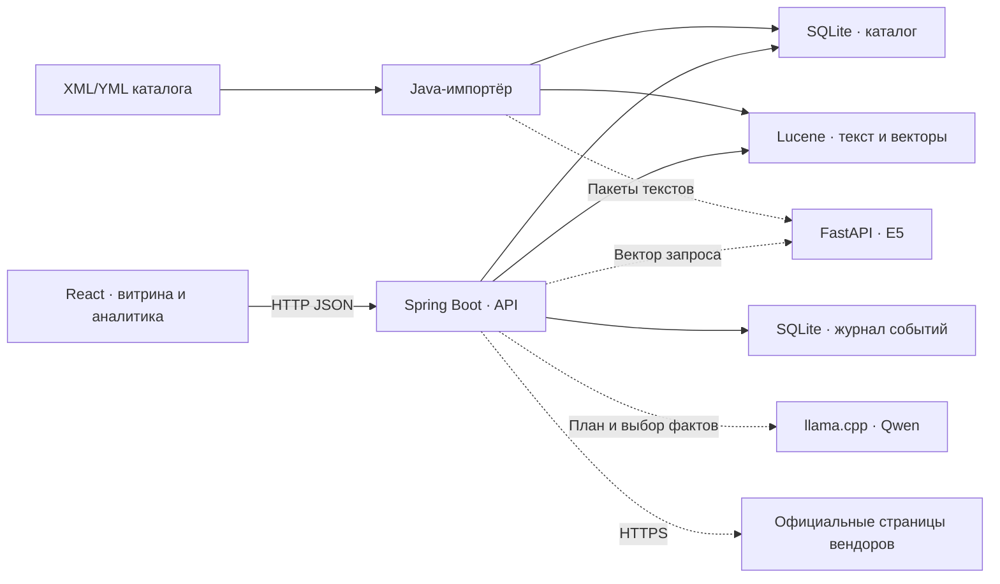

# Умный поиск Softline · итоговое исследование

Срез реализации — `master@1fdd463`. Практический запуск описан в [README.md](README.md).

## Задача и исходные данные

Организаторы поставили задачу улучшить поиск ПО и оборудования по смыслу, сленгу и опечаткам. Бриф оценивает нагрузку примерно в 500 поисковых обращений в день и ассортимент примерно в 200 тыс. наименований. Эти оценки описывают магазин. Для прототипа использовался конкретный снимок каталога, размеченная выборка из десяти запросов и уточнения организаторов. [ТЗ](supplementary/Technical_details_smart_search.pdf) · [Эталонные запросы](supplementary/SearchQueries.xlsx) · [Q&A](supplementary/QnA_smart_search.md) · [Дополнительные ответы](supplementary/userQnA.md)

| Требование | Результат на текущем срезе |
| --- | --- |
| Различать задачи и типы продукции | Поиск учитывает артикул, бренд, название, версию, контекст и назначение. «Сервер» и «ПО для сервера» проходят разные ветви отбора. Покрытие бытовых переформулировок ограничено. |
| Находить нужную сущность и показывать четыре товара | Явное совпадение может вести к предложению, семейству, вендору или подборке. `top4` содержит до четырёх различимых семейств или самостоятельных предложений. При дефиците валидных прямых результатов допускаются подтверждённые дополнения. Причина недобора доступна в ответе. |
| Предлагать сопутствующие решения | Совместимые дополнения, похожие предложения и редакционные рекомендации имеют разные основания. Отдельный `upsell` сохраняет роль товара и не увеличивает счётчик прямых совпадений. |
| Повысить шансы на успешный поиск во время ввода | Подсказки с третьего символа ведут в сущность каталога. Покупатель может выбрать подсказку мышью или клавиатурой. |
| Сравнивать цены и показывать акции при наличии данных | Старая и текущая цены берутся из фида. Внешнее сравнение работает для подтверждённых позиций двух вендоров. Покрытие ограничено списком адаптеров. |
| Диагностировать неудачные поиски и оценивать допродажи | Отчёт по журналу показывает выдачу, взаимодействия и причины неудач. Заказы можно передавать через контракт событий. Реальный коммерческий эффект требует данных заказчика и эксперимента. |

[Реализация обработчика](backend/src/main/java/ru/codesraider/smartsearch/search/SearchController.java) · [HTTP API](README.md#разработка-и-контракты-api)

Выгрузка `Mindbox.yml.gz.xml` от 25 ноября 2026 года содержала 136 040 предложений, из которых 44 601 отмечено как доступные. Исторический разбор нашёл 4 413 исходных групп, 8 125 предложений без `group_id` и 44 978 артикулов в `vendorCode`. В дереве 9 311 категорий, из них 335 указаны непосредственно у предложений. У 2 129 предложений было содержательное значение версии, у 1 029 — платформы, у 32 доступных предложений старая цена превышала текущую. Такие пропуски влияют на применимость фильтров и проверки совместимости. В текущем импорте позиция без семейства остаётся доступна через самостоятельный ключ. Группировка оборудования по подтверждённой модели меняет итоговые счётчики. В снимке `catalog-v1.5` получилось 8 679 семейств и 12 229 карточек каталога. [Код импорта](backend/src/main/java/ru/codesraider/smartsearch/catalog/CatalogImporter.java)

Десять эталонных запросов задают первый переход. Например, «МТС» ведёт к вендору `webinar`, «Кибер Бэкап» — в подборку `cyberprotect-1033`, а широкий запрос `astra linux` — в семейство 121231. В оценке различаются правильность маршрута, релевантность первых карточек и качество рекомендаций. [Эталонные запросы](supplementary/SearchQueries.xlsx) · [Тесты навигации](backend/src/test/java/ru/codesraider/smartsearch/search/BackupNavigationTest.java)

## Архитектура

Spring Boot 4.1.3 на Java 21 отдаёт React-сборку на том же origin, где доступны публичные API. Один образ выполняет импорт и запускает приложение. Lucene 10.6 хранит текстовый и, при импорте с моделью, векторный индекс. Каталог SQLite открывается на чтение. Записи поиска и событий идут в отдельную базу SQLite. Это упрощает публикацию одного проверенного снимка и развёртывание на одном узле. Частое обновление цен и остатков либо многорепличная запись потребуют отдельного решения для публикации и журнала. [Зависимости Spring](backend/pom.xml) · [Образы](Dockerfile) · [Тома и сервисы](compose.yaml) · [Схема каталога](contracts/sql/catalog-v1.sql) · [Схема событий](contracts/sql/events-v2.sql)

FastAPI с `intfloat/multilingual-e5-small` кодирует текст на CPU. Размер нормализованного вектора — 384. Профиль привязан к ревизии весов и схеме предобработки. Qwen работает отдельным сервером через Compose-надстройку. Java решает, какие поля запроса применяются, какой SKU подходит, какие цены и ссылки возвращаются. [Энкодер и его профиль](model/encoder.py) · [Модельный API](contracts/model.openapi.yaml) · [Конфигурация Qwen](compose.llm.yaml)

## Реестр функций

| Функция | Что происходит и как проверить | Статус и границы |
| --- | --- | --- |
| Каталог и навигация | `GET /v1/catalog` отдаёт представителей семейств, самостоятельные товары и фасеты. При переходе в семейство открываются варианты. | Реализовано. У конкретного предложения собственный ID, а `family_key` сохраняет группировку для выдачи и аналитики. [Каталог](frontend/src/CatalogPage.jsx) · [Переходы](frontend/src/EntityPage.jsx) |
| Подсказки | После трёх символов строка запрашивает `/v1/suggest`. Выбор передаёт `selected_target` с типом и ID. Проверочный префикс — `EP2-0`. | Реализовано. API возвращает до шести подсказок, учитывает совместимый контекст и каталог. [Проверки подсказок](backend/src/test/java/ru/codesraider/smartsearch/catalog/ContextualSuggestTest.java) |
| Поиск и разбор задачи | `POST /v1/search` возвращает прямые результаты, навигационную цель, аналоги, рекомендации, фасеты и `search_id`. Артикул `EP2-06605` ведёт к предложению 473582. | Реализовано. Точные артикулы и явные ограничения проверяются на конкретной позиции. Возможности семантики и Qwen зависят от конфигурации. [Публичный контракт](contracts/search.openapi.yaml) |
| Фильтры, сортировка и страницы | Фильтры категории, производителя, наличия, бюджета и лицензии хранятся в URL. Есть сортировка по релевантности и цене. Каталог получает страницы с сервера. Поиск делит до 50 возвращённых карточек по 20. | Реализовано. Ограничения применяются к одному SKU, а сортировка и смена фильтров возвращают пользователя на подходящую страницу. [Фильтры](frontend/src/Filters.jsx) · [Проверка пагинации](backend/acceptance/storefront_smoke.py) |
| Карточка и описание | Сущность из `/v1/entities/{kind}/{id}` показывает цену, наличие, описание и характеристики. «Почему этот товар?» объясняет показ по `search_id` и `offer_id` через `/v1/explain`. | Реализовано. Поля зависят от полноты фида. Иллюстрации представлены локальным плейсхолдером. [Карточка](frontend/src/OfferDetail.jsx) · [Объяснение](frontend/src/ResultExplanation.jsx) |
| Корзина и покупка | Товары сохраняются в браузере, подтверждение показывается в интерфейсе. | Демонстрация. Касса, оплата и интеграция с системой заказов относятся к следующему этапу. [Корзина](frontend/src/CartPage.jsx) |
| ИИ-помощник | Чат отправляет запросы с `strategy=llm`, передаёт историю и показывает карточки каталога. Кнопка «+» начинает новый чат. Подсказка начального экрана — «Офис без подписки». | Реализовано с ограничениями. В браузере хранятся три последних диалога до семи дней с последнего сообщения. При выключенной LLM действуют правила и текущий индекс. [Чат](frontend/src/AssistantChat.jsx) · [Хранение диалогов](frontend/src/chatHistory.js) |
| Рекомендации и аналоги | Результаты имеют отдельные блоки `alternatives` и `upsell`. Рекомендации поиска появляются ниже выдачи. Страница предложения показывает `related_offers` при наличии подтверждённых дополнений. | Реализовано с ограничениями. Аналоги обрабатываются для предусмотренных случаев, например для отсутствующей модели принтера или версии. Общая подборка не является доказательством совместимости. [Запросы к каталогу](backend/src/main/java/ru/codesraider/smartsearch/search/SearchCatalog.java) · [Тесты рекомендаций](backend/src/test/java/ru/codesraider/smartsearch/search/UpsellSuggestionsTest.java) |
| Сравнение цен | Карточка отдельно загружает `/v1/entities/offer/{id}/price-comparison`. Показаны обе суммы, дата снимка, время проверки и официальный источник. | Ограниченное покрытие. Поддерживаемые позиции и условия описаны ниже. [Адаптеры](backend/src/main/java/ru/codesraider/smartsearch/search/VendorPrices.java) · [Интерфейс](frontend/src/PriceComparison.jsx) |
| Аналитика | `POST /v1/events` принимает события. `GET /v1/analytics` строит отчёт по периоду, источнику и версии индекса. Можно учитывать показы, клики, переформулировки, корзины и переданные в API заказы. | Реализовано для собранного журнала. События дедуплицируются по ID, атрибуция требует связи с ранее зарегистрированным поиском. [Отчёт](frontend/src/AnalyticsPage.jsx) · [События](#журнал-и-аналитика) |

## Пайплайн импорта

1. Утилита `app import` читает XML/YML потоковым StAX. Формат gzip определяется по сигнатуре. DTD и внешние сущности отключены. Импортёр вычисляет SHA-256 выгрузки и формирует версию с учётом рецепта и, при наличии, профиля энкодера.
2. Из фида строятся сущности предложений, семейств, вендоров, категорий и подборок. Цены нормализуются в минорные единицы валюты. Извлечённые параметры относятся к конкретному SKU. Для товаров без семейства ключ карточки равен `offer/<id>`.
3. Во временном каталоге создаются `catalog.db`, индекс `lucene/` и `manifest.json`. Lucene индексирует текст и ключ карточки. Опция `--embeddings` добавляет векторы из FastAPI. Манифест хранит счётчики, версию рецепта, профиль и диагностику редакционных ID.
4. После проверок импортёр атомарно обновляет указатель `snapshots/active`. Текущий процесс обслуживает запросы из открытого снимка. Перезапуск `app` открывает новую версию. Журнал сохраняется в отдельном томе. При старте сверяются манифест и версии SQLite/Lucene. [Импортёр](backend/src/main/java/ru/codesraider/smartsearch/catalog/CatalogImporter.java) · [Lucene-индекс](backend/src/main/java/ru/codesraider/smartsearch/catalog/CatalogIndex.java) · [Чтение снимка](backend/src/main/java/ru/codesraider/smartsearch/search/SearchIndex.java)

## Пайплайн запроса

1. React передаёт строку, фильтры и при необходимости выбранную подсказку или контекст диалога. Spring валидирует запрос, нормализует раскладку и написание и разбирает признаки назначения, артикула, версии и лицензии.
2. Точную цель обслуживают каталожные поля и словари. Для широких запросов Lucene группирует кандидатов по ключу карточки. Лексический путь использует BM25, название, атрибуты и корректировки написания. Гибридный путь добавляет близкие векторы E5 и объединяет ранги. Для запуска гибридного пути нужно, чтобы снимок содержал векторы и живой энкодер сообщил совпадающий профиль. Ошибка или тайм-аут энкодера оставляет лексическую выдачу.
3. При неоднозначном запросе правила могут дополнить разбор вызовом Qwen. Допустимый план сверяется с каталогом. Наличие, цены, SKU и ссылки формируются из подтверждённых данных. Для конкретных запросов и многих ясных задач модель не вызывается. Ответ содержит `mode`, `program.compiler` и `llm_applied`, по которым можно определить фактический путь.
4. Сервер применяет ограничения, выбирает представителей и формирует `top4`, следующие прямые результаты, аналоги и рекомендации. Журнал сохраняет запрос, выбранные ID и диагностические признаки. Клиент отправляет события показа и клика с сохранением блока и роли. [План запроса](backend/src/main/java/ru/codesraider/smartsearch/search/QueryPlan.java) · [Поиск по индексу](backend/src/main/java/ru/codesraider/smartsearch/search/SearchIndex.java) · [Обработчик](backend/src/main/java/ru/codesraider/smartsearch/search/SearchController.java)

В объяснении `/v1/explain` Spring восстанавливает факты ранее показанной карточки. При настроенной LLM эти факты могут участвовать в выборе пояснения. Это ограниченное использование найденного контекста. Векторный поиск ранжирует карточки каталога. Для пояснений используется журнал, а для проверки совместимости — конкретные подтверждённые правила и атрибуты. [Пояснение по зафиксированному результату](backend/src/main/java/ru/codesraider/smartsearch/search/SearchController.java)

### Дополнения, похожие предложения и аналоги

- `complement` — подтверждённое дополнение с якорным SKU и успешными проверками. Например, PC-211P для Pantum P2500W и TL-C2318H для Pantum BM1800W. Неизвестная версия лицензии оставляет соответствующую пару без подтверждения.
- `related` — предложения в отдельном `upsell`. Spring использует подтверждённые связи, подходящие расходники и похожие предложения из категории. Если блок остался пуст, используется список редакционных ID. Выбор из него стабилен для одного нормализованного запроса, кандидаты проходят фильтры, исключение дублей, проверку наличия и цены. Такой блок помечается `curated_fallback` и ограничен восемью карточками.
- `alternative` — отдельный вариант для предусмотренного случая замены с явным отличием, например другая версия или модель. При провале прямого поиска `direct_count` остаётся нулевым даже при показе рекомендаций.

В связях Astra Linux и Кибер Бэкапа имеет значение точная пара версий. Если в фиде версия конкретного SKU отсутствует, совместимость семейства на основании реестра нельзя переносить на эту поставку. На страницах предложений показываются до четырёх подтверждённых дополнений. В новом снимке `card_key` участвует в группировке текста и векторов, а поля `target_kind`, `target_id` и `offer_count` описывают переход и число вариантов. [Редакционные ID](backend/src/main/resources/search/curated-offers.txt) · [Проверки рекомендаций](backend/src/test/java/ru/codesraider/smartsearch/search/UpsellSuggestionsTest.java)

### Сравнение цен

Spring запрашивает заранее заданные HTTPS-страницы вендоров. Поддерживаются Pantum P2500W по опубликованной РРЦ, Pantum BM1800W, PC-211P и TL-C2318H по доступной цене магазина Pantum и «Кибер Бэкап Старт» Стандартная на один ПК без облачного хранилища на один год. Сопоставление выполняется по вендору и артикулу. Запрос к источнику проверяет модель или комплектацию и цену в RUB. Для Pantum Shop дополнительно проверяется доступность предложения.

РРЦ подписывается отдельно. Разница — цена источника минус цена каталога в копейках. Знак определяет текст о более низкой или высокой цене. Успешные значения кешируются на шесть часов, неудачные проверки — на десять минут. При отсутствии подходящего совпадения API возвращает `204`, и карточка работает без блока сравнения. На дату проверки Pantum P2500W в текущем снимке стоил 10 368 ₽ при опубликованной РРЦ в 10 590 ₽. [Официальная РРЦ](https://www.pantum.ru/products/laser-devices/monohromnyj-printer-p2500w/) · [Проверки парсеров](backend/src/test/java/ru/codesraider/smartsearch/search/VendorPricesTest.java)

### Журнал и аналитика

Успешный запрос создаёт запись `search_log` с параметрами, версией снимка, результатами и диагностикой. Витрина регистрирует `impression`, `click`, `reformulation` и `add_to_cart`. Внешний адаптер может передавать `order`. Пакет событий пишется транзакционно, а повторный `event_id` сохраняет первую запись. Для показа или клика используются `search_id`, `offer_id`, `family_key`, `role`, `block` и `position`. Переход к вендору или категории содержит `target_kind` и `target_id`.

Позиция заказа связывается с последним предшествующим кликом по тому же `offer_id` в той же сессии. При отсутствии подходящего клика `search_id` заказа пуст. Отчёт учитывает поиски из полуоткрытого периода `[from, to)`, а действия после поиска ищет в истории соответствующих сессий. Сессия считается завершённой после 30 минут бездействия. При нулевом знаменателе значение метрики равно `null`.

| Метрика | Числитель | Знаменатель |
| --- | --- | --- |
| `zero_result_rate` | Поиски с `direct_count=0` | Все поиски |
| `abandonment_rate` | Завершённые неуспешные сессии без последующего клика или заказа | Завершённые сессии с неудачей поиска |
| `conversion_rate` | Сессии с хотя бы одной атрибутированной позицией заказа | Поисковые сессии |

`source=demo` отделяет действия на стенде от `source=seed` для синтетических событий. В `failures` есть группы причин и примеры запросов. Отчёт служит диагностике, а численные результаты пилота требуют реальных пользовательских данных. [Журнал](backend/src/main/java/ru/codesraider/smartsearch/analytics/EventStore.java) · [Расчёт метрик](backend/src/main/java/ru/codesraider/smartsearch/analytics/AnalyticsService.java) · [Проверка аналитики](backend/src/test/java/ru/codesraider/smartsearch/analytics/SearchMetricsTest.java)

## История разработки

| Этап | Артефакт и критерий выхода |
| --- | --- |
| Постановка задачи и базовый эксперимент | Материалы организаторов и первоначальный прототип из PR №3. На исходном FTS5/BM25 по названиям 44 601 доступного предложения результат нашёлся для 9 из 10 запросов, четыре разные группы — для 3 из 10. «Сервер» возвращал ПО и повторяющиеся конфигурации DEPO, а `max patrol` с пробелом давал пустой ответ. Это выявило необходимость разделять оборудование и ПО, нормализовать составные имена и группировать варианты. |
| Развёртывание и контракты | PR №4 добавил Docker-основу, PR №5 — интерактивные контракты, PR №6 — архитектуру бэкенда. Типы целей, форматы карточек и событий согласуются через OpenAPI. [Контракты](contracts/) |
| Каталог, поиск и наблюдаемость | PR №7 добавил бэкенд каталога, PR №8 — контекстные подсказки. Последующие итерации развивали задачи покупателей, E5, логи и приёмку. Проверки охватывали путь от запроса до конкретного SKU и причины результата. [Измерения](#проверки-и-измерения) |
| Интеграция витрины и помощника | PR №14 объединил обработчик, PR №15 добавил сценарии диалога, PR №18 объединил витрину и сравнение цен. Пользовательский сценарий включает запрос, фильтры, карточку, пробную корзину и события. |
| Иерархия, рекомендации и запуск на VM | Правила иерархии и допродаж зафиксированы в `catalog-v1.5`. Коммит `f2443f7` добавил скрипт гибридного импорта, `e208e24` и `1fdd463` уточнили настройки доступа за прокси. Результат — возобновляемый запуск из снапшота с отдельным журналом. [Инструкция запуска](README.md) |

## Проверки и измерения

| Проверка на `master@1fdd463` | Результат |
| --- | --- |
| Сборка Docker на Windows с Linux-контейнерами | Spring и React собраны. 67 тестов Java прошли. |
| React и OpenAPI | 5 тестов Node, сборка Vite и 6 тестов HTTP-контракта Python прошли. Версионируемые схемы совпали с экспортом. Профиль `docs` отдал обе схемы, а корректный справочный вызов вернул `501`. |
| Демокаталог и нагрузка на loopback | Проверены 10 эталонных запросов и регрессии каталога. 240 запросов при 12 клиентах без ошибок. p50 — 148,4 мс, p95 — 247,6 мс. |
| Полный каталог, лексический импорт | Снимок `27eaec9e77942c61-cf909bf98782` активирован, readiness `UP`, в витрине 12 229 карточек. Поиск по `EP2-06605` привёл в предложение 473582. «МТС» и «Кибер Бэкап» вернули ожидаемые типы навигации. По неизвестной модели ответ сохранил ноль прямых совпадений и отдельный редакционный блок. |
| Помощник и внешний источник | Лексический чат вернул ответ на «Офис без подписки», хотя на этом прогоне прямых карточек было ноль. Для Pantum P2500W проверен ответ со сравнением РРЦ. |

Для текущего среза профили `ml` и Qwen сверены по конфигурации Compose. Следующие измерения относятся к прежним сборкам и отдельным размеченным наборам:

| Эксперимент | Результат и условия |
| --- | --- |
| Демо, сравнение SQLite BM25 и интеграции | На 57 положительных и 13 отрицательных примерах SQLite BM25 дал 21/57 правильных первых карточек и 4/13 корректно пустых выдач. Интеграция E5 и правил дала 54/57 и 13/13 при p95 48,7 мс, а с Qwen — 57/57 и 13/13 при p95 905,9 мс. При оценке HTTP-режимов выполняли 210 поисков на режим. SQLite измерялся отдельно внутри Python. [Benchmark](backend/acceptance/benchmark-results.csv) |
| Полный каталог, ранний поиск по задачам | Снимок `27eaec9e77942c61-7acea18042d6`, E5 и локальная Qwen на CPU. На 30 отложенных задачах между `master@82c8bb1` и следующей сборкой `iskander` Hit@1 вырос с 9/30 до 24/30, nDCG@4 — с 0,307 до 0,778. В отдельных регрессиях первая позиция по точному артикулу выросла с 51/64 до 64/64. [Наборы задач](backend/acceptance/catalog_tasks.tsv) |
| Полный каталог, разбор формулировок | Для 30 дополнительных задач при сравнении с `master@022fca6` с Qwen подходящий тип товара на первом месте вырос с 2/30 до 19/30 в новой сборке с Qwen. Без Qwen та же новая сборка дала 1/30. Задержки измеряли по трём прогретым повторам на запрос. [Прогоны переформулировок](backend/acceptance/paraphrase-results.csv) |
| Полный каталог, назначение запроса | По сравнению с `master@d8f7ff9` на 18 отложенных задачах Hit@1 вырос с 7/18 до 14/18, nDCG@4 с 0,385 до 0,692. Опциональная подсказка назначения от E5 сохранила те же значения качества, p95 изменился с 966 до 834 мс относительно режима по умолчанию в новой сборке. [Отложенные запросы](backend/acceptance/task_goal_holdout.tsv) · [Разметка](backend/acceptance/task_goal_titles.json) · [Результаты](backend/acceptance/task-goal-results.csv) |
| Полный каталог, диалоговый подбор | На 180 примерах с E5 и Qwen между `master@71cdb27` и новой версией чата первый точный результат вырос с 123/132 до 128/132, nDCG@4 с 0,813 до 0,862. Для запросов вне ассортимента корректные пустые ответы выросли с 46/48 до 48/48. p95 изменился с 1 179 до 1 423 мс. [Ответы чата](backend/acceptance/assistant-results.csv) |

Hit@1 и Hit@4 оценивают прямые карточки. nDCG@4 учитывает их релевантность и позиции. Правильность навигационной цели измеряется отдельно по эталонному URL. Для допродажи проверяются допустимые пары SKU и основания совместимости, а пустая прямая выдача оценивается по `direct_count`. Использованные наборы содержат запросы разработки и отложенные примеры, поэтому показатели описывают качество на этих данных. [Разметка демо](backend/acceptance/judgments.tsv) · [Команды воспроизведения](README.md#проверка-остановка-и-диагностика)

## Границы реализации

Покрытие версий, платформ и типов лицензий зависит от исходных атрибутов. Для редких товаров может отсутствовать как внешний источник цены, так и подтверждённое дополнение. Снимок отражает каталог на дату выгрузки. Система готова к пилотной проверке сценариев прототипа. Для оценки конверсии, стоимости эксплуатации и эффекта допродаж потребуются реальные сессии, заказы и согласованный эксперимент.
