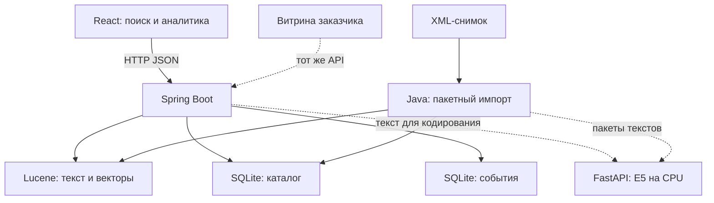

# Техническая архитектура поиска Softline Store

**Решение на 48 часов.** Поисковый API, каталог, ранжирование и аналитика работают в одном приложении на Java 21 и Spring Boot. React на JavaScript обслуживает витрину. В основной объём входит журнал с отчётом о неудачах, отдельный экран менеджера идёт следующим по приоритету. FastAPI обслуживает одну операцию — преобразует текст в вектор. Java принимает все решения о товаре, цене, версии лицензии и порядке показа. Владелец витрины впоследствии сможет подключить свою строку поиска к тому же HTTP API.

**Контракт организатора.** Первая товарная выдача — топ‑4 разных семейств. Совпадение засчитывается по продуктовой группе. При двух прямых совпадениях допустимы две программно проверенные допродажи. Цены, наличие и акции читаем из снимка. Агентный фреймворк опционален. [Ответы организатора, пп. 1–10](../supplementary/userQnA.md)

## 1. Границы компонентов



**Что меняется относительно первого плана.** SQLite FTS5 остаётся воспроизводимой точкой отсчёта. Поисковый движок приложения — встроенный Apache Lucene с BM25, точными полями и векторным поиском. Это использует сильную сторону выбранной Java-платформы и позволяет сравнивать выдачу с моделью и без неё на одном каталоге. Выделенный поисковый кластер и векторная БД добавили бы развёртывание, синхронизацию и восстановление ещё одного сервиса. При заданных примерно 500 поисках в день оснований закладывать такую работу в хакатон нет. Предел этой архитектуры — один узел. Необходимость нескольких пишущих экземпляров или частых обновлений остатков станет поводом пересмотреть хранение и публикацию индекса. [Apache Lucene](https://lucene.apache.org/core/) · [Конкурентная запись SQLite](https://www.sqlite.org/wal.html)

**Процессы на стенде.** Публичный контейнер `app:8080` отдаёт и React-сборку, и API с одного origin. Внутренний контейнер `model:8000` включается Compose-профилем `ml`. Импорт — разовая команда того же Java-образа. На клиентской машине нужны только браузер и URL. Модель и индексы подготавливаются заранее. При выключенном профиле доступны весь лексический поиск, подсказки, рекомендации с проверкой характеристик и журнал неудач. [Статические ресурсы Spring MVC](https://docs.spring.io/spring-boot/reference/web/servlet.html) · [Профили Compose](https://docs.docker.com/compose/how-tos/profiles/)

## 2. Библиотеки и инструменты

| Слой | Выбор для прототипа | Где использовать |
|---|---|---|
| Java и сборка | Eclipse Temurin JDK 21, Maven Wrapper 3.9.x, `org.springframework.boot:spring-boot-starter-parent:4.1.3` | Один Maven-модуль `backend/` с пакетами `catalog`, `search`, `analytics`, `modelclient`. Версии стартеров берёт на себя Spring Boot. [Требования JDK/Maven](https://docs.spring.io/spring-boot/4.1/system-requirements.html) |
| Публичный API | Из группы `org.springframework.boot` взять `spring-boot-starter-webmvc`, `spring-boot-starter-validation`, `spring-boot-starter-restclient`, `spring-boot-starter-actuator` | MVC-контроллеры, Java records для DTO, Bean Validation, `RestClient` для модели. Ошибки API через `ProblemDetail`, таймеры поиска через Micrometer. [Список стартеров](https://docs.spring.io/spring-boot/4.1/reference/using/build-systems.html) · [RestClient](https://docs.spring.io/spring-framework/reference/integration/rest-clients.html) |
| Поиск | `org.apache.lucene:lucene-core`, `lucene-analysis-common`, `lucene-grouping`, все версии **10.6.0** | `FSDirectory`, `IndexWriter`, `IndexSearcher`, BM25, `RussianAnalyzer`, `GroupingSearch`, векторные поля. Префиксные подсказки по отдельному полю индексируются тем же движком. [Выпуск Lucene](https://lucene.apache.org/core/downloads) · [Возможности движка](https://lucene.apache.org/core/) |
| Каталог и события | JDK StAX (`javax.xml.stream`), `spring-boot-starter-jdbc`, `org.xerial:sqlite-jdbc`, `JdbcTemplate` | Два явно настроенных источника JDBC. `catalog.db` доступна на чтение сервису выдачи, `events.db` — на запись с короткими транзакциями. SQL-миграции событий нумеруются. [StAX](https://docs.oracle.com/en/java/javase/21/docs/api/java.xml/javax/xml/stream/XMLInputFactory.html) · [SQLite JDBC](https://github.com/xerial/sqlite-jdbc) |
| Интерфейс | Node 24 для сборки, `react` и `react-dom` 19.x, Vite 8, `@vitejs/plugin-react`, JavaScript/JSX, CSS | Первая страница — выдача. Отдельный экран аналитики планируется после обязательных сценариев. Нативные `fetch`, `AbortController`, `URLSearchParams`. В разработке — Vite proxy к Spring, при поставке — `dist/` в `classpath:/static/`. [React](https://react.dev/versions) · [Vite](https://vite.dev/guide/) |
| Модель | Python 3.12, `fastapi`, `uvicorn`, `pydantic` 2, `sentence-transformers`, CPU-сборка `torch`, веса `intfloat/multilingual-e5-small` | Один процесс Uvicorn и одна копия модели. Загрузка и прогрев в `lifespan`, `SentenceTransformer.encode(..., normalize_embeddings=True)`. [FastAPI lifespan](https://fastapi.tiangolo.com/advanced/events/) · [Sentence Transformers](https://sbert.net/docs/package_reference/sentence_transformer/model.html) · [Карточка E5](https://huggingface.co/intfloat/multilingual-e5-small) |
| Приёмка | `spring-boot-starter-webmvc-test` с JUnit Jupiter/MockMvc, `pytest` + `httpx` для FastAPI, `@playwright/test` для браузера | Контракт и ранжирование, форма/размерность вектора, сценарий от ввода запроса до клика в аналитике. Офлайн-оценщик читает JSONL и вызывает тот же публичный API. [Spring Boot starters](https://docs.spring.io/spring-boot/4.1/reference/using/build-systems.html) · [Playwright](https://playwright.dev/docs/intro) |

Версии остальных прямых зависимостей зафиксировать при первой успешной сборке в `pom.xml`, `package-lock.json` и `uv.lock`. Для Python зафиксировать также источник CPU-сборки PyTorch. Для модели записать точный commit SHA весов. Повторные сборки проверять через Maven Wrapper, `npm ci` и `uv sync --locked`. Внешний ключ для базового прототипа не нужен. [Фиксация Python-окружения](https://docs.astral.sh/uv/concepts/projects/sync/)

## 3. Каталог и поисковый индекс

Проверен полный проход **на Java 21**, с потоковым StAX, отключённой загрузкой DTD и внешних сущностей и лимитом JVM heap 128 МиБ. На рабочей машине чтение и подсчёт заняли **1,45 с**. Импортёр прочитал 136 040 предложений, 44 601 доступное, 4 413 непустых групп, 8 125 позиций без группы. Показатель относится к чтению XML. Время записи SQL, построения Lucene и кодирования E5 нужно измерить отдельно. Использовать `XMLInputFactory.SUPPORT_DTD=false` и `IS_SUPPORTING_EXTERNAL_ENTITIES=false` — в снимке есть ссылка на внешний `shops.dtd`.

| Объект | Представление | Что предотвращает |
|---|---|---|
| Предложение | `offer(offer_id PK, entity_key, family_key, vendor_id, category_id, sku_raw, sku_norm, name, url, available, price_minor, currency, …)`. Повторяющиеся параметры — отдельные строки `offer_param`. Срок, версия, тип лицензии, количество и единица измерения — типизированные поля при подтверждённом значении. | Проверка «1 год, продление, 5 ПК» относится к одному SKU. Нулевая цена и отсутствие значения различимы. Индекс на `sku_norm` допускает повторы. |
| Семейство и навигация | `entity(entity_key PK, kind, name, canonical_url, …)`, `category(id,parent_id)`, `alias(term,entity_key,scope)`. Для составной подборки хранить `collection_scope(entity_key PK, vendor_id, category_id)` в том же снимке. У ПО `family_key=family/{group_id}`. У оборудования `offer_id` остаётся ключом SKU, `family_key` строится по вендору и подтверждённой базовой модели через справочник нормализации. | Конфигурации одного DEPO Storm 3470S2A занимают одно место. Если модель не извлечена уверенно, позицию можно открыть по артикулу. До подтверждения группы она не даёт отдельного места в четвёрке. Вендор и подборка остаются навигационными сущностями. |
| Lucene | Документы `offer` содержат точный SKU, исходное и нормализованное имя, семейство, категорию, назначение, описание и фасеты. Документы `entity` содержат имя/алиасы и целевой ключ. `SortedDocValuesField(family_key)` на предложениях используется для группировки. Вектор индексируется только у семейств ПО и аппаратных позиций. | Сотни похожих лицензий не занимают весь выдаваемый список. Повторные SKU одной модели оборудования также сворачиваются в одну карточку. |
| Аналитика | `search_log(search_id PK, session_id, q, selected_target_kind, selected_target_id, direct_count, shown_family_count, shortfall_reason, mode, index_version, elapsed_ms, source, ts)` и `event(event_id PK, search_id, session_id, type, offer_id, target_kind, target_id, family_key, role, position, ts, source)`. Для свободного ввода оба поля `selected_target_*` пусты. У товарного события `offer_id` идентифицирует конкретное предложение. | Повтор доставки дедуплицируется по `event_id`. Для атрибуции заказа используется клик по тому же `offer_id`. События `seed` и посетителей демо анализировать раздельно. Для базы событий использовать WAL, `busy_timeout` и короткие транзакции. |
| Проверка допродаж | `relation(anchor_family,candidate_family,rule_id,source_url)` и версионированные правила по типу связи. Для ПО Java сравнивает у двух SKU обязательные платформу, версию, редакцию и вид лицензии. Для расходников правило сверяет вендора, код модели устройства и код расходника с перечнем производителя. | Сохранять входные значения, источник и результат каждого сравнения. После изменения правила или снимка повторять проверки на тех же парах SKU. |

**Матрица цены и наличия.** Применять после проверки пригодности товара для роли (прямое совпадение или дополнение к конкретному SKU). Искать кандидатов первой очереди до решения о резерве, включая уже не попавшие в первоначальный top‑k. Резервные SKU того же семейства доступны в деталях карточки.

| Данные снимка | Число предложений | Правило вывода |
|---|---:|---|
| `available=true`, цена > 0 | 44 601 | Первая очередь. Показывать цену снимка, среди совместимых SKU семьи предпочитать предложение этой очереди |
| `available=false`, цена > 0 | 11 170 | Рабочая трактовка смешанного случая — при отсутствии подходящих доступных с ценой использовать резерв с пометкой об отсутствии и известной цене |
| `available=false`, цена = 0 | 80 269 | Резерв при отсутствии подходящих предложений с ценой. Возвращать `price_minor=null`, помечать «Цена не указана» и отсутствие в наличии |
| Цена пропущена или равна нулю при `available=true` | В снимке таких строк не выявлено | Для будущего снимка сохранять исходный флаг наличия, применять резервное правило цены и пометку об отсутствии цены |

Онлайн-запрос к магазину для расчёта цены не требуется. Для акции проверять `oldprice > price > 0` у одного доступного SKU. Не связывать отсутствие цены с возможностью заказа.
**Публикация снимка.** Импорт читает переданный путь к XML, создаёт каталог версии с `catalog.db`, папкой Lucene и манифестом. В манифесте — дата и хеш источника, счётчики, версия словаря и профиль эмбеддингов. При ошибке импорта старая версия продолжает обслуживать трафик. Для хакатона достаточно закончить построение, проверить 10 эталонов, атомарно заменить указатель активной версии на том же диске и перезапустить приложение. Предыдущий каталог сохранить для отката. Файл событий хранится в отдельном томе. Обогащённый векторами снимок публикуется тем же способом.

## 4. Путь запроса и точность

1. **Распознать цель.** При выборе подсказки разрешить полученную пару `kind` и `target_id` в текущем снимке и применить явные фильтры. При свободном вводе начать с точного SKU/ID, затем применить регистр, дефисы, раскладку, кириллицу/латиницу и версионированные синонимы. Использовать `TermQuery` по точным полям, `PhraseQuery` по названиям, `RussianAnalyzer` для русских описаний и отдельное поле без стемминга для брендов. Нечёткое совпадение через ограниченный `FuzzyQuery` разрешать только для словарного слова. Цифры в «365», версия «5.0» и артикулы сохраняются. Из текста извлечь тип продукта и ограничения на предложение. Контекст категории, сегмента и текущей сессии разрешает неоднозначность.
2. **Получить лексических кандидатов.** Собрать `BooleanQuery` c фильтрами на уровне SKU и весами полей. Исходное соотношение весов — семейство 8, название 6, вендор 4, категория 3, атрибуты 2, описание 1. Взять первые 100 различных ключей по BM25, группируя предложения по `family_key`. Независимо проверить точный индекс сущностей для навигации. Уникальный артикул возвращает конкретный товар, даже когда у него есть семейство. Для недоступного точного SKU сохранить информационный переход со статусом. Его попадание в товарную четвёрку подчиняется правилам резерва. Если покупатель прямо перечислил модели через «или», искать каждую модель по точному коду в пределах запрошенного типа товара. Упоминание модели устройства в описании картриджа само по себе не даёт расходнику роль `direct`.
3. **Добавить смысловой поиск по задаче.** При импорте Java отправляет названия, назначение и категорию в FastAPI пачками до 32. Python добавляет префикс `passage: `, возвращает нормализованные векторы, Java сохраняет их как `KnnFloatVectorField` с `DOT_PRODUCT`. При запросе «хочу вернуть файлы после сбоя» FastAPI кодирует один `query: `, Java ищет top-50 через `KnnFloatVectorQuery`. Для 12 538 потенциальных документов сырые float32-векторы занимают 18,4 МиБ. Граф Lucene, веса модели и служебные данные требуют дополнительной памяти. Для уникального SKU и подсказок Python не вызывается. [Формат E5](https://huggingface.co/intfloat/multilingual-e5-small) · [Векторный поиск Lucene](https://lucene.apache.org/core/)
4. **Объединить и перепроверить.** Перевести оба списка к подтверждённому `family_key` и объединить их методом reciprocal rank fusion. Для каждого ключа сложить `1/(60 + rank)` по тем спискам, в которых он встречается. Первой позиции соответствует ранг 1. В каждом исходном списке оставить лучший результат на подтверждённый `family_key`, затем заново пронумеровать семейства от 1 без пропусков и вычислить RRF. Документ аппаратного SKU сохраняет собственный ID, все конфигурации подтверждённой базовой модели используют общий ключ семейства. В Java пакетно загрузить варианты из SQLite и проверить на одном предложении все обязательные условия. Снять семантического кандидата, если ни одна его лицензия им не соответствует, и добрать кандидатов при необходимости. Например, семейство «КриптоПро CSP 5.0» содержит предложения с явной версией 4.0. При отсутствии подтверждения версии карточка не попадает в точные совпадения. Популярность и демонстрационная маржа могут менять порядок внутри близкой по релевантности группы.
5. **Собрать топ‑4.** Java выбирает подходящий SKU-представитель каждого прямого семейства. Сначала заполняет позиции прямыми совпадениями, затем — допродажами из ещё не показанных семейств. Один набор использованных `family_key` действует на весь ответ. В примере «2 + 2» позиции 1–2 получают роль `direct`, 3–4 — `complement` с опорным SKU. Навигационная ссылка на вендора или подборку показывается отдельно. При нуле прямых совпадений в том же ответе вернуть подходящий функциональный аналог в `alternatives[]`. Для замены явно указанной отсутствующей модели сохранить назначение и обязательные свойства на одном SKU, указать отличие модели в `differences[]`. Неизвестное обязательное свойство исключает кандидата. Если подходящей замены нет, массив пуст. При нехватке проверенных семейств вернуть доступное число и `shortfall_reason`.

**Программная проверка пары.** Взять правило связи и нормализованные атрибуты основного и дополнительного SKU. Для каждого обязательного предиката вычислить `pass`, `fail` или `unknown` и сохранить поле, сравниваемые значения и источник. Совместимое дополнение проходит только при `pass` по всем обязательным предикатам. При `fail`, `unknown` или отсутствии правила кандидат исключается из топ‑4, причина пишется в диагностический журнал. Проверенный внешний источник можно заранее привести к структурированной матрице поддерживаемых версий. Ссылки и текстовое объяснение сопровождают результат сравнения.

Для пары «устройство — картридж» брать нормализованные `vendorCode` двух предложений и вендора из XML. При импорте сохранить таблицу совместимости Pantum с URL источника и версией правила. Например, в перечне устройств для TL-C2318H есть BM1800W, а P2500W в этом перечне отсутствует. Первая пара даёт `pass`, вторая — `fail`. Пропуск обязательного кода или отсутствие сведений о совместимости даёт `unknown`. В `checks[]` вернуть сравниваемые коды, источник и результат, в `anchor_offer_id` — ID реально показанного устройства. [Модели Pantum для TL-C2318H](https://www.pantum.ru/options-and-supplies/toner-kartridzh-tl-c2318h/) · [Контрольная подборка из XML](HACKATHON_PLAN.md#две-подтверждённые-допродажи)

**Если модель медленная или недоступна.** Лексический поиск и запрос эмбеддинга можно запустить одновременно. Для онлайн-кодирования выделить начальный общий бюджет 200 мс внутри целевых 500 мс поиска. Ограничить число одновременно выполняемых запросов к модели и время ожидания HTTP в Spring. При тайм-ауте, перегрузке, несовпадении идентификатора профиля или неверной размерности сразу вернуть лексический ответ с `mode=lexical`. На стороне FastAPI выполнять CPU-инференс в ограниченном пуле вне цикла обработки HTTP. При заполненной очереди вернуть `503`. Фоновая проверка готовности возвращает семантику в работу. Для пакетной индексации использовать отдельный, более длинный тайм-аут. Подобрать размер пачки и бюджет на машине показа.

## 5. HTTP-контракты

Контракты доступны в [OpenAPI поиска](../contracts/search.openapi.yaml) и [OpenAPI энкодера](../contracts/model.openapi.yaml). Имена полей в JSON — `snake_case`, идентификаторы товаров — строки. Стоимость передаётся целым числом в минимальных денежных единицах с кодом валюты. Команды для запуска Swagger, примеры и правила обработки ошибок приведены в [руководстве по интеграции](SEARCH_API.md).

| Метод | Вход | Ответ и поведение |
|---|---|---|
| `POST /v1/search` | `q`, необязательные `session_id`, `context{category_id,segment,profile_id}`, `filters`, `selected_target{kind,target_id}`. `limit` по умолчанию 4, до 50 для расширенного просмотра. | `search_id`, `index_version`, `mode`, `normalized_q`, `applied_filters`, `primary_target`, `direct_count`, `top4[]`, `more_results[]`, `alternatives[]`, `shortfall_reason`. `top4[]` задаёт порядок первой четвёрки. Дополнительные прямые семейства при увеличении `limit` идут в `more_results[]`. В позиции — `family_key`, `offer_id`, `role`, `offer_tier`, цена, доступность и причина. У `complement` также `anchor_offer_id` и `checks[]`. `direct_count` считает различные пригодные прямые семейства после применения фильтров и выбора очереди цены, до ограничения выдачи. `alternatives[]` показываются ниже. `shortfall_reason=null` при четырёх семействах, иначе `NO_DIRECT_MATCH` или `NOT_ENOUGH_VERIFIED_FAMILIES`. `200` при пустой выдаче, `400` при ошибке входа, `503` при отсутствии каталога. |
| `GET /v1/suggest?q=…` | Префикс и при необходимости `category_id` | До 6 элементов с полями `kind`, `target_id`, `label`. При клике или Enter React передаёт `kind` и `target_id` выбранной строки в `selected_target` поиска, а в `q` сохраняет введённый текст. При вводе выдерживает паузу около 120 мс и отменяет устаревшие запросы. |
| `GET /v1/entities/{kind}/{id}` | Тип и ID сущности из карточки или подсказки | Карточка сущности со ссылкой. Для семейства вернуть варианты лицензий с их характеристиками и наличием. При открытии повторно применить фильтры из query-параметров. |
| `POST /v1/events` | Массив событий с `event_id`, `session_id`, `type`, `ts` и `search_id` для событий поиска. Для товарного `click`, `add_to_cart` и каждой позиции `order` обязателен фактический `offer_id`. У клика по карточке выдачи передать `family_key`, `role` и позицию. У навигационного клика — `target_kind` и `target_id`. `search_id` заказа вычисляет сервис. | `204` после транзакции, повтор с тем же `event_id` идемпотентен. Поиск один раз регистрирует Spring, показы и клики — React, покупки — демонстрационный адаптер. При переходе на Softline использовать `fetch(..., {keepalive:true})`. |
| `GET /v1/analytics?from=…&to=…&source=…` | Период и источник событий | Числители и знаменатели нулевых запросов, уходов, конверсии, причины неудач с примерами запросов. Воронку строить по сессиям, отделять прямые совпадения от рекомендаций. |
| `GET /health` | — | Версия каталога, готовность основного поиска, состояние семантики. Для внутреннего мониторинга использовать также Spring Actuator. Потеря модели допускает готовность основного поиска. |
| `POST /internal/v1/embeddings` (FastAPI) | `input_type` = `query` или `passage`, `texts[]`, ожидаемый `profile_id`. Онлайн — один текст, импорт — до 32 | `profile_id`, `dimension=384`, `vectors[][]` в исходном порядке. Профиль фиксирует модель, SHA, префиксы и нормализацию. Spring проверяет число векторов, размерность и конечность чисел. `409` при несовпадении профиля, `422` при ошибке входа, `503` при перегрузке или незагруженной модели. `GET /ready` проверяет прогрев. |

**Выбор подсказки.** Типы товарных и навигационных подсказок — `offer`, `family`, `vendor`, `category`, `collection`. Например, в ответе на префикс `EP2-0` клиент получил `kind=offer` и строковый `target_id="473582"`. При выборе он отправляет в `POST /v1/search` следующий JSON.

```json
{
  "q": "EP2-0",
  "selected_target": {"kind": "offer", "target_id": "473582"}
}
```

Spring проверяет тип и ID в активном снимке. Для этого примера ожидается `primary_target.kind=offer` и `primary_target.id=473582`. ID в JSON передаются строками. При неизвестном сочетании вернуть `400` с кодом `UNKNOWN_TARGET`. Клиент обновляет список подсказок. При обычном Enter без выбранной строки действует свободный поиск по `q`.

**Подборка «кибер бэкап».** Импортёр сохраняет в справочник навигации запись `collection/cyberprotect-1033` с именем, алиасами, каноническим URL и предикатом `vendor_id=cyberprotect AND category_id=1033`. Ключ вендора соответствует пути `vendorUrl` в снимке. Разбор полного текста и разрешение выбранной подсказки возвращают одну и ту же запись. При поиске и открытии подборки Spring пересекает её неизменяемую область с явными фильтрами клиента до ранжирования, включая резерв и выбор дочерних переходов. При конфликте известная подборка остаётся целью, прямых совпадений нет. Неизвестный ID подсказки даёт 400, неизвестный ID в маршруте сущности — 404. Явный фильтр версии, в том числе `17.2`, требует значения у конкретного предложения. Параметр XML «другое или отсутствует» означает `unknown`. Применять один предикат и к лексическим, и к векторным кандидатам, и при чтении дочерних ссылок из SQLite. Навигационный переход не занимает позицию топ-4. [Сквозной пример](SEARCH_API.md#кибер-бэкап-от-подсказки-до-подборки)

**Атрибуция заказа.** Одна товарная позиция заказа передаётся одним событием `order` со своим `event_id` и `offer_id`. Найти последний по времени товарный клик с теми же `session_id` и `offer_id`, совершённый до заказа. Взять у него `search_id`. Если такого клика нет, сохранить позицию с `search_id=null`. В конверсию сессия входит один раз, если удалось связать с поиском хотя бы одну её позицию заказа. При переходе по навигационной ссылке `offer_id` может отсутствовать, такой клик сохраняется только для аналитики навигации.

**Контрактный пример из выгрузки.** Для `POST /v1/search` с телом `{"q":"EP2-06605","limit":4}` первая позиция должна содержать следующие поля. Ниже фрагмент ответа для автотеста. Число различных `family_key` и результаты проверки дополнений тестировать по полному `top4[]`.

```json
{
  "primary_target": {
    "kind": "offer",
    "id": "473582",
    "url": "https://store.softline.ru/microsoft/ep2-06605-473582/"
  },
  "top4": [{
    "family_key": "family/391338",
    "role": "direct",
    "offer_tier": "primary",
    "offer_id": "473582",
    "sku": "EP2-06605",
    "price_minor": 3658400,
    "currency": "RUB",
    "available": true,
    "reason_codes": ["EXACT_SKU"]
  }]
}
```

В XML цена этого предложения — 36 584 рубля, код `RUR`. Адаптер переводит его в `RUB` и копейки. Другой приёмочный запрос, «Microsoft Office для дома и бизнеса», должен вывести семейство 391338 среди прямых позиций топ‑4. Его канонический URL из Excel дополнительно проверяем в навигации. Эта пара проверяет, что система различает намерение купить известный артикул и намерение выбрать продукт.

**Внешняя LLM — отдельный эксперимент.** Если B и C продолжают терять запросы со сложным описанием задачи, Java может вызвать Yandex AI Studio через `RestClient` запросом `POST https://ai.api.cloud.yandex.net/foundationModels/v1/completion`. Подготовить API-ключ, URI выбранной модели и дневной лимит. Передавать обезличенный текст, получать по `jsonSchema` только намерение, категорию и ограничения с подтверждающими фрагментами текста. Проверить значения по словарю и исходному запросу. Измерять токены, p95 и качество отдельно. Базовый режим запускается без ключа. Локально работают только эмбеддинги. [Контракт API провайдера](https://aistudio.yandex.ru/ru/docs/ai-studio/text-generation/api-ref/TextGeneration/completion)

## 6. Порядок реализации

Расчёт на трёх участников. Первый отвечает за Java и поиск, второй — за React и публичный API совместно с первым, третий — за данные, оценку и Python. Критический путь проходит через импорт, совпадение по SKU, выдачу по семейству, запись клика и отчёт о неудачах. Минимальный сквозной прогон допускает синтетическую фикстуру, как в одобренном примере на 25 товарах. Приёмка выполняется на полном снимке Softline. Это первая демонстрация до подключения модели.

| Часы | Java и поиск | React и интеграция | Данные, оценка, модель | Проверяемый результат |
|---|---|---|---|---|
| 0–4 | Maven Wrapper, стартеры, StAX, схема SQLite | Vite, витрина, контракт `top4[]` и пример ответа | Разобрать 8 семейств и 2 навигационные цели, сохранить исходный прогон, подготовить разметку и шаблон стоимости | Контракт согласован. React показывает ответ-заглушку того же формата, Java читает полный XML |
| 4–12 | Импорт полного снимка, точный SKU, `family_key`, Lucene BM25, очередь цены | Подключить реальный поиск и карточку, зарегистрировать клики | Проверить реальные дубли и матрицу наличия/цены, записать mock-сессии, подготовить независимые запросы | EP2-06605 открывает предложение 473582, название Office — страницу семейства. Клик виден в журнале |
| 12–20 | Нормализация, строгие фильтры, правила проверки пары SKU | Подсказки, два синтетических B2B-профиля, видимые роли | Прогнать `pass/fail/unknown`, зафиксировать закрытую выборку | Один запрос меняет порядок с учётом профиля. Журнал объясняет отклонение несовместимого кандидата |
| 20–28 | Собрать четыре уникальных семейства, проверить дефицит и резерв | Показать Pantum «2 + 2», статусы цены и журнал неудач | Прогнать совместимые и несовместимые пары из XML, «мтс» и атрибуцию заказа по SKU | На полном каталоге лексический режим проходит проверки выдачи и событий |
| 28–34 | При готовом ядре подключить E5 и RRF, проверить отключение модели | Сквозной тест, p95, при запасе времени — экран менеджера | Слепое сравнение B/C, нагрузочный прогон, отчёт по ошибкам и расходам | Принято решение о включении E5. Эксперимент с LLM возможен только при выполненном обязательном объёме |
| 34–42 | Исправить критические дефекты, проверить восстановление версии | Разместить собранный стенд и пройти сценарий со второго устройства | Финальный регрессионный прогон, расчёт стоимости, проверка ссылок | Публичный URL открывается, перезапуск сохраняет события, локальный поиск работает без внешней сети |
| 42–46 | Зафиксировать SHA сдаваемой сборки и версию снимка | Записать на финальном стенде и опубликовать непрерывное демо до 3 минут | Сверить описание, список компонентов и расчёт стоимости по шаблону | Ссылки ведут к работающему стенду, ролику, коду с историей и скачиваемой смете |
| 46–48 | Сверить инструкцию запуска и резервную копию | Повторно открыть материалы со второго устройства | Капитан отправляет комплект через личный кабинет | Сдача завершена до 28 ноября, 10:00 МСК. Порядок записи и состав заявки — [в плане](HACKATHON_PLAN.md#комплект-сдачи) |

**Как выбрать финальный режим.** A — исходный SQLite FTS5, B — Java/Lucene с правилами, C — тот же B плюс E5. Цели команды на Excel — FamilyHit@4 8/8 по продуктовым запросам и 2/2 корректных перехода для вендора и подборки. Совпадение засчитывать по прямой позиции семейства в первой четвёрке. На независимых описаниях задач включить E5 только при приросте nDCG@4 не менее 0,05, сохранении результатов по семействам и точным артикулам и p95 поиска до 500 мс. Бюджет подсказок — 150 мс. Нагрузочный прогон — минимум 200 запросов с 5 параллельными клиентами, включая холодный старт и отказ FastAPI. Выбор алгоритма обосновать качеством и себестоимостью. Отдельный агент не обязателен.

**Приёмка обработчика Spring.** После активации тестового снимка запустить [JUnit-проверки по HTTP](../backend/src/test/java/ru/codesraider/smartsearch/SearchHandlerIT.java). Порядок подготовки четырёх снимков, команды Maven и ожидаемые результаты приведены в [руководстве по API](SEARCH_API.md#приёмка-поискового-обработчика-spring). Один и тот же набор применяется к лексическому и, если включён, гибридному поиску. Перед демонстрацией вернуть полный снимок и отдельно проверить эталоны Excel.

**Контрактные тесты до показа.** Приоритет для пилота по второму [Q&A](../supplementary/userQnA.md) — качество допродаж. Для каждого размеченного сценария записать показанные пары SKU и их источники, число ошибочных пар среди показанных и сколько ожидаемых подтверждённых пар удалось показать. В базовом Pantum ожидается 2 из 2 подходящих пар и 0 ошибочных. Проверять множество пар независимо от порядка внутри роли.

- Четыре лицензии одной группы дают одну позицию. Несколько конфигураций DEPO Storm 3470S2A также занимают одну позицию. Для общего запроса «сервер» подобрать четыре разные готовые модели.
- Для запроса «Покажи устройства Pantum P2500W или BM1800W» ожидать `direct_count=2`, четыре различных `family_key` и роли `direct, direct, complement, complement`. У P2500W допускается один представитель из `363882` и `521380`, у BM1800W — `521379`. PC-211P (`526683`) ссылается на показанный P2500W, TL-C2318H (`513625`) — на `521379`. У обеих допродаж заполнены `anchor_offer_id` и успешные проверки. Порядок внутри одной роли свободный.
- Изменение версии в тестовой паре даёт `fail`, удаление обязательного свойства — `unknown`. Если после исключений осталось три годных семейства, ответ содержит три позиции и причину недобора. Для запроса без совпадений проверить пустой `top4` и `direct_count=0`.
- Для запроса «мтс» проверить `primary_target.kind=vendor` и путь `/webinar/`. Набор прямых `family_key` равен `family/414326`, `family/447242`, `family/447243` без учёта порядка. При отсутствии проверенной связи `direct_count=3`, длина `top4` равна 3 и `shortfall_reason=NOT_ENOUGH_VERIFIED_FAMILIES`. При добавлении подходящего дополнения его роль — `complement`, якорь входит в показанную тройку, а `direct_count` по-прежнему равен 3.
- На полном снимке проверить `fail` для P2500W и TL-C2318H и `unknown` для предложения «Кибер Бэкап» с неподтверждённой версией при правиле о версии 17.2. В обоих случаях пара отсутствует среди допродаж.
- Проверить приоритет на контролируемом наборе с одинаковым назначением и всеми тремя комбинациями снимка. При наличии подходящего доступного товара с ценой резерв в той же роли пропускается. После его удаления показывается недоступный с известной ценой, после удаления и этого — предложение без цены. Отдельно проверить отображение фактических статусов на SKU 61557, 48093 и 504 соответственно.
- При одинаковом тексте запроса сравнить два помеченных синтетических профиля. Явное условие версии или платформы должно сохраняться в обоих случаях. Журнал регистрирует одно событие поиска и верные позиции независимо от наличия экрана аналитики.
- Выбрать подсказку для `EP2-0` мышью и клавишей Enter. В каждом отдельном прогоне ожидается один поиск с исходным `q`, типом `offer`, ID `473582` и ссылкой на это предложение. Проверить свободный ввод без `selected_target` и ответ `400 UNKNOWN_TARGET` для исчезнувшей цели.
- В одной демосессии кликнуть по предложению `363882` и передать заказ `521380`. При отсутствии клика по `521380` заказ сохраняется без атрибуции поиску. Затем передать заказ `363882`, повторить доставку с тем же `event_id` и проверить один связанный заказ, одну сессию в числителе конверсии и `search_id` исходного клика.

## 7. Что подготовить к старту и передаче

| Ресурс | Для чего нужен |
|---|---|
| Исходные данные | XML находится уровнем выше репозитория, его путь передать импортёру через `CATALOG_PATH`. [10 целей](../supplementary/SearchQueries.xlsx), [ТЗ](../supplementary/Technical_details_smart_search.pdf), [исходное Q&A](../supplementary/QnA_smart_search.md) и [уточнения организатора](../supplementary/userQnA.md) лежат в репозитории. Явно пометить синтетические клики, заказы и маржу. |
| Машина показа | Стартовая оценка для прогона — Linux x86-64, 4 vCPU, 8 ГиБ RAM и 20 ГиБ свободного локального SSD с местом под два снимка, сборку и веса. GPU не требуется по выбранной схеме. Это гипотеза для измерения на реальном сервере. |
| Сборка и запуск | Планируемые точки входа — `docker compose run --rm app import`, `docker compose up -d app` и `docker compose --profile ml up -d`. Для индекса с векторами поднять прогретый `model`, выполнить импорт с флагом `--embeddings` и активировать проверенный снимок. Режим `SEMANTIC_MODE=auto` включает семантику только при наличии векторов и совпадении профиля прогретого сервиса. У `app` нет обязательной зависимости запуска от `model`. Docker Engine и доступ к реестрам нужны на машине сборки. Для автономного показа заранее сохранить образы, снимок и веса. |
| Рабочее окружение проекта | Здесь обнаружены JDK 21, Node 24 и Compose CLI. Служба Docker Engine недоступна из текущей сессии, системные `mvn` и `npm` в PATH не обнаружены. Maven Wrapper и Node-образ сборки снимают зависимость от этих двух локальных команд. Проверка полного контейнерного запуска входит в первые четыре часа на машине команды. |
| Интеграция с Softline | Передать OpenAPI, словарь причин, форматы импорта и событий, версии индекса/модели, отчёт о качестве и стоимости. Для пилота понадобятся канонические URL, регулярные цены и наличие, реальные поисковые события с заказами и коммерческие признаки. Конверсию сравнивать после включения экспериментальной группы. Сроки доступности стенда и расчёт руб./запрос — в [плане сдачи](HACKATHON_PLAN.md). |
