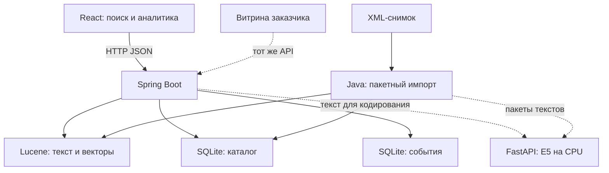

# Техническая архитектура поиска Softline Store

**Решение на 48 часов.** Поисковый API, каталог, ранжирование и аналитика работают в одном приложении на Java 21 и Spring Boot. React на JavaScript даёт покупателю и менеджеру два экрана. FastAPI обслуживает одну операцию — преобразует текст в вектор. Java принимает все решения о товаре, цене, версии лицензии и порядке показа. Владелец витрины впоследствии сможет подключить свою строку поиска к тому же HTTP API.

## 1. Границы компонентов



**Что меняется относительно первого плана.** SQLite FTS5 остаётся воспроизводимой точкой отсчёта. Поисковый движок приложения — встроенный Apache Lucene с BM25, точными полями и векторным поиском. Это использует сильную сторону выбранной Java-платформы и позволяет сравнивать выдачу с моделью и без неё на одном каталоге. Выделенный поисковый кластер и векторная БД добавили бы развёртывание, синхронизацию и восстановление ещё одного сервиса. При заданных примерно 500 поисках в день оснований закладывать такую работу в хакатон нет. Предел этой архитектуры — один узел. Необходимость нескольких пишущих экземпляров или частых обновлений остатков станет поводом пересмотреть хранение и публикацию индекса. [Apache Lucene](https://lucene.apache.org/core/) · [Конкурентная запись SQLite](https://www.sqlite.org/wal.html)

**Процессы на стенде.** Публичный контейнер `app:8080` отдаёт и React-сборку, и API с одного origin. Внутренний контейнер `model:8000` включается Compose-профилем `ml`. Импорт — разовая команда того же Java-образа. На клиентской машине нужны только браузер и URL. Модель и индексы подготавливаются заранее. При выключенном профиле доступны весь лексический поиск, подсказки, рекомендации по проверенным связям и аналитика. [Статические ресурсы Spring MVC](https://docs.spring.io/spring-boot/reference/web/servlet.html) · [Профили Compose](https://docs.docker.com/compose/how-tos/profiles/)

## 2. Библиотеки и инструменты

| Слой | Выбор для прототипа | Где использовать |
|---|---|---|
| Java и сборка | Eclipse Temurin JDK 21, Maven Wrapper 3.9.x, `org.springframework.boot:spring-boot-starter-parent:4.1.3` | Один Maven-модуль `backend/` с пакетами `catalog`, `search`, `analytics`, `modelclient`. Версии стартеров берёт на себя Spring Boot. [Требования JDK/Maven](https://docs.spring.io/spring-boot/4.1/system-requirements.html) |
| Публичный API | Из группы `org.springframework.boot` взять `spring-boot-starter-webmvc`, `spring-boot-starter-validation`, `spring-boot-starter-restclient`, `spring-boot-starter-actuator` | MVC-контроллеры, Java records для DTO, Bean Validation, `RestClient` для модели. Ошибки API через `ProblemDetail`, таймеры поиска через Micrometer. [Список стартеров](https://docs.spring.io/spring-boot/4.1/reference/using/build-systems.html) · [RestClient](https://docs.spring.io/spring-framework/reference/integration/rest-clients.html) |
| Поиск | `org.apache.lucene:lucene-core`, `lucene-analysis-common`, `lucene-grouping`, все версии **10.6.0** | `FSDirectory`, `IndexWriter`, `IndexSearcher`, BM25, `RussianAnalyzer`, `GroupingSearch`, векторные поля. Префиксные подсказки по отдельному полю индексируются тем же движком. [Выпуск Lucene](https://lucene.apache.org/core/downloads) · [Возможности движка](https://lucene.apache.org/core/) |
| Каталог и события | JDK StAX (`javax.xml.stream`), `spring-boot-starter-jdbc`, `org.xerial:sqlite-jdbc`, `JdbcTemplate` | Два явно настроенных источника JDBC. `catalog.db` доступна на чтение сервису выдачи, `events.db` — на запись с короткими транзакциями. SQL-миграции событий нумеруются. [StAX](https://docs.oracle.com/en/java/javase/21/docs/api/java.xml/javax/xml/stream/XMLInputFactory.html) · [SQLite JDBC](https://github.com/xerial/sqlite-jdbc) |
| Интерфейс | Node 24 для сборки, `react` и `react-dom` 19.x, Vite 8, `@vitejs/plugin-react`, JavaScript/JSX, CSS | Две страницы — выдача и аналитика. Нативные `fetch`, `AbortController`, `URLSearchParams`. В разработке — Vite proxy к Spring, при поставке — `dist/` в `classpath:/static/`. [React](https://react.dev/versions) · [Vite](https://vite.dev/guide/) |
| Модель | Python 3.12, `fastapi`, `uvicorn`, `pydantic` 2, `sentence-transformers`, CPU-сборка `torch`, веса `intfloat/multilingual-e5-small` | Один процесс Uvicorn и одна копия модели. Загрузка и прогрев в `lifespan`, `SentenceTransformer.encode(..., normalize_embeddings=True)`. [FastAPI lifespan](https://fastapi.tiangolo.com/advanced/events/) · [Sentence Transformers](https://sbert.net/docs/package_reference/sentence_transformer/model.html) · [Карточка E5](https://huggingface.co/intfloat/multilingual-e5-small) |
| Приёмка | `spring-boot-starter-webmvc-test` с JUnit Jupiter/MockMvc, `pytest` + `httpx` для FastAPI, `@playwright/test` для браузера | Контракт и ранжирование, форма/размерность вектора, сценарий от ввода запроса до клика в аналитике. Офлайн-оценщик читает JSONL и вызывает тот же публичный API. [Spring Boot starters](https://docs.spring.io/spring-boot/4.1/reference/using/build-systems.html) · [Playwright](https://playwright.dev/docs/intro) |

Версии остальных прямых зависимостей зафиксировать при первой успешной сборке в `pom.xml`, `package-lock.json` и `uv.lock`. Для Python зафиксировать также источник CPU-сборки PyTorch. Для модели записать точный commit SHA весов. Повторные сборки проверять через Maven Wrapper, `npm ci` и `uv sync --locked`. Внешний ключ для базового прототипа не нужен. [Фиксация Python-окружения](https://docs.astral.sh/uv/concepts/projects/sync/)

## 3. Каталог и поисковый индекс

Проверен полный проход **на Java 21**, с потоковым StAX, отключённой загрузкой DTD и внешних сущностей и лимитом JVM heap 128 МиБ. На рабочей машине чтение и подсчёт заняли **1,45 с**. Импортёр прочитал 136 040 предложений, 44 601 доступное, 4 413 непустых групп, 8 125 позиций без группы. Показатель относится к чтению XML. Время записи SQL, построения Lucene и кодирования E5 нужно измерить отдельно. Использовать `XMLInputFactory.SUPPORT_DTD=false` и `IS_SUPPORTING_EXTERNAL_ENTITIES=false` — в снимке есть ссылка на внешний `shops.dtd`.

| Объект | Представление | Что предотвращает |
|---|---|---|
| Предложение | `offer(offer_id PK, entity_key, vendor_id, category_id, sku_raw, sku_norm, name, url, available, price_minor, currency, …)`. Повторяющиеся параметры — отдельные строки `offer_param`. Срок, версия, тип лицензии, количество и единица измерения — типизированные поля при подтверждённом значении. | Проверка «1 год, продление, 5 ПК» относится к одному SKU. Нулевая цена и отсутствие значения различимы. Индекс на `sku_norm` допускает повторы. |
| Семейство и навигация | `entity(entity_key PK, kind, name, canonical_url, …)`, `category(id,parent_id)`, `alias(term,entity_key,scope)`, `relation(from_key,to_key,type,source_url,version_scope)`. Для ПО ключ `family/{group_id}`, для аппаратного товара `offer/{offer_id}`. Другие типы — вендор и подборка «вендор + категория». | Закрывает восемь семейств и две навигационные цели из Excel. При отсутствии канонической ссылки открывается локальная карточка с проверенными URL предложений. |
| Lucene | Документы `offer` содержат точный SKU, исходное и нормализованное имя, семейство, категорию, назначение, описание и фасеты. Документы `entity` содержат имя/алиасы и целевой ключ. `SortedDocValuesField(entity_key)` на предложениях используется для группировки. Вектор индексируется только у семейств ПО и аппаратных позиций. | Сотни похожих лицензий не занимают весь выдаваемый список. Дубликаты названия у оборудования дополнительно сверяются по артикулу и конфигурации. |
| Аналитика | `search_log(search_id PK, session_id, q, direct_count, mode, index_version, elapsed_ms, source, ts)` и `event(event_id PK, search_id, session_id, type, item_id, block, position, ts, source)`. Локальный диск, WAL, `busy_timeout`, короткие пакетные записи. | Повтор доставки клика не удваивает конверсию. Переиндексация не затрагивает историю. Метку `seed` отличать от действий посетителей демо. |

**Публикация снимка.** Импорт читает переданный путь к XML, создаёт каталог версии с `catalog.db`, папкой Lucene и манифестом. В манифесте — дата и хеш источника, счётчики, версия словаря и профиль эмбеддингов. При ошибке импорта старая версия продолжает обслуживать трафик. Для хакатона достаточно закончить построение, проверить 10 эталонов, атомарно заменить указатель активной версии на том же диске и перезапустить приложение. Предыдущий каталог сохранить для отката. Файл событий хранится в отдельном томе. Обогащённый векторами снимок публикуется тем же способом.

## 4. Путь запроса и точность

1. **Распознать цель.** Начать с точного SKU/ID, потом применить регистр, дефисы, раскладку, кириллицу/латиницу и версионированные синонимы. Использовать `TermQuery` по точным полям, `PhraseQuery` по названиям, `RussianAnalyzer` для русских описаний и отдельное поле без стемминга для брендов. Нечёткое совпадение через ограниченный `FuzzyQuery` разрешать только для словарного слова. Цифры в «365», версия «5.0» и артикулы сохраняются. Из текста извлечь тип продукта и ограничения на предложение. Контекст категории, сегмента и текущей сессии разрешает неоднозначность.
2. **Получить лексических кандидатов.** Собрать `BooleanQuery` c фильтрами на уровне SKU и весами полей. Исходное соотношение весов — семейство 8, название 6, вендор 4, категория 3, атрибуты 2, описание 1. Взять первые 100 различных ключей по BM25, группируя предложения по `entity_key`. Независимо проверить точный индекс сущностей для навигации. Уникальный артикул возвращает конкретный товар, даже когда у него есть семейство. Для недоступного точного SKU сохранить точный ответ со статусом.
3. **Добавить смысловой поиск по задаче.** При импорте Java отправляет названия, назначение и категорию в FastAPI пачками до 32. Python добавляет префикс `passage: `, возвращает нормализованные векторы, Java сохраняет их как `KnnFloatVectorField` с `DOT_PRODUCT`. При запросе «хочу вернуть файлы после сбоя» FastAPI кодирует один `query: `, Java ищет top-50 через `KnnFloatVectorQuery`. Для 12 538 потенциальных документов сырые float32-векторы занимают 18,4 МиБ. Граф Lucene, веса модели и служебные данные требуют дополнительной памяти. Для уникального SKU и подсказок Python не вызывается. [Формат E5](https://huggingface.co/intfloat/multilingual-e5-small) · [Векторный поиск Lucene](https://lucene.apache.org/core/)
4. **Объединить и перепроверить.** Перевести оба списка к `entity_key` и объединить их методом reciprocal rank fusion. Для каждого ключа сложить `1/(60 + rank)` по тем спискам, в которых он встречается. Первой позиции соответствует ранг 1. В Java пакетно загрузить варианты из SQLite и проверить на одном предложении все обязательные условия. Снять семантического кандидата, если ни одна его лицензия им не соответствует, и добрать кандидатов при необходимости. Например, семейство «КриптоПро CSP 5.0» содержит предложения с явной версией 4.0. При отсутствии подтверждения версии карточка не попадает в точные совпадения. Популярность и демонстрационная маржа могут менять порядок внутри близкой по релевантности группы.
5. **Собрать ответ покупателю.** Сначала прямые совпадения, отдельно альтернативы, сопутствующие товары и резервная подборка. Навигация по «мтс» ведёт на `/webinar/`, по «кибер бэкап» — к вендору с фильтром категории 1033. Голый «сервер» показывает готовые машины, «почтовый сервер» — ПО. Для редкого запроса добрать до четырёх разных товарных карточек с явной ролью. Учитывать отсутствие прямого совпадения в аналитике даже при заполненном экране. У допродажи хранить источник, у скидки проверять `oldprice > price > 0`. Вопрос о зачёте резервных карточек вынесен на Q&A в [продуктовом плане](HACKATHON_PLAN.md).

**Если модель медленная или недоступна.** Лексический поиск и запрос эмбеддинга можно запустить одновременно. Для онлайн-кодирования выделить начальный общий бюджет 200 мс внутри целевых 500 мс поиска. Ограничить число одновременно выполняемых запросов к модели и время ожидания HTTP в Spring. При тайм-ауте, перегрузке, несовпадении идентификатора профиля или неверной размерности сразу вернуть лексический ответ с `mode=lexical`. На стороне FastAPI выполнять CPU-инференс в ограниченном пуле вне цикла обработки HTTP. При заполненной очереди вернуть `503`. Фоновая проверка готовности возвращает семантику в работу. Для пакетной индексации использовать отдельный, более длинный тайм-аут. Подобрать размер пачки и бюджет на машине показа.

## 5. HTTP-контракты

Контракт публичного API оформить в `contracts/search.openapi.yaml` в первые четыре часа. Имена полей в JSON — `snake_case`, идентификаторы товаров — строки. Стоимость передаётся целым числом в минимальных денежных единицах с кодом валюты. Внутренний Python-контракт описывают модели Pydantic и сгенерированный FastAPI `/openapi.json`.

| Метод | Вход | Ответ и поведение |
|---|---|---|
| `POST /v1/search` | `q`, необязательные `session_id`, `context{category_id,segment}`, `filters`, `limit` (по умолчанию 10, до 50) | `search_id`, `index_version`, `mode`, `normalized_q`, `applied_filters`, `primary_target`, `direct_count`, `results[]`, `alternatives[]`, `complements[]`, `fallback[]`. У карточки есть ID сущности и SKU, URL, цена, наличие, причина. `direct_count` считает различные подтверждённые совпадения в рассмотренном пуле до ограничения выдачи. `200` при нуле совпадений, `400` при ошибке входа, `503` при отсутствии пригодного каталога. |
| `GET /v1/suggest?q=…` | Префикс и при необходимости `category_id` | До 6 элементов с типом, подписью и `target_id`. React отправляет после паузы около 120 мс, отменяет устаревший запрос. Учитывать клавиатурную навигацию и выбор Enter. |
| `GET /v1/entities/{kind}/{id}` | Тип и ID из карточки или подсказки | Название семейства, ссылка и варианты лицензий с характеристиками и доступностью. При открытии экрана Java повторно проверяет применённые фильтры, переданные как query-параметры. |
| `POST /v1/events` | Массив событий с `event_id`, `search_id`, `session_id`, временем, типом и данными карточки | `204` после транзакции. Повтор с тем же ID идемпотентен. Поиск регистрирует сервер один раз при выдаче, показы и клики — React, заказ в прототипе — демонстрационный адаптер. Для клика с уходом на Softline использовать `fetch(..., {keepalive:true})`. |
| `GET /v1/analytics?from=…&to=…&source=…` | Период и источник событий | Числители и знаменатели нулевых запросов, уходов, конверсии, причины неудач с примерами запросов. Воронку строить по сессиям, отделять прямые совпадения от рекомендаций. |
| `GET /health` | — | Версия каталога, готовность основного поиска, состояние семантики. Для внутреннего мониторинга использовать также Spring Actuator. Потеря модели допускает готовность основного поиска. |
| `POST /internal/v1/embeddings` (FastAPI) | `input_type` = `query` или `passage`, `texts[]`, ожидаемый `profile_id`. Онлайн — один текст, импорт — до 32 | `profile_id`, `dimension=384`, `vectors[][]` в исходном порядке. Профиль фиксирует модель, SHA, префиксы и нормализацию. Spring проверяет число векторов, размерность и конечность чисел. `409` при несовпадении профиля, `422` при ошибке входа, `503` при перегрузке или незагруженной модели. `GET /ready` проверяет прогрев. |

**Контрактный пример из выгрузки.** Для `POST /v1/search` с телом `{"q":"EP2-06605","limit":4}` первая позиция должна содержать следующие поля. Ниже фрагмент ответа для автотеста. Проверку обязательных четырёх карточек выполнять по полному ответу.

```json
{
  "primary_target": {
    "kind": "offer",
    "id": "473582",
    "url": "https://store.softline.ru/microsoft/ep2-06605-473582/"
  },
  "results": [{
    "entity_key": "family/391338",
    "offer_id": "473582",
    "sku": "EP2-06605",
    "price_minor": 3658400,
    "currency": "RUB",
    "available": true,
    "reason_codes": ["EXACT_SKU"]
  }]
}
```

В XML цена этого предложения — 36 584 рубля, код `RUR`. Адаптер переводит его в `RUB` и копейки. Другой приёмочный запрос, «Microsoft Office для дома и бизнеса», должен вернуть первым канонический URL семейства 391338 из Excel. Эта пара проверяет, что система различает намерение купить известный артикул и намерение выбрать продукт.

**Внешняя LLM — отдельный эксперимент.** Если B и C продолжают терять запросы со сложным описанием задачи, Java может вызвать Yandex AI Studio через `RestClient` запросом `POST https://ai.api.cloud.yandex.net/foundationModels/v1/completion`. Подготовить API-ключ, URI выбранной модели и дневной лимит. Передавать обезличенный текст, получать по `jsonSchema` только намерение, категорию и ограничения с подтверждающими фрагментами текста. Проверить значения по словарю и исходному запросу. Измерять токены, p95 и качество отдельно. Базовый режим запускается без ключа. Локально работают только эмбеддинги. [Контракт API провайдера](https://aistudio.yandex.ru/ru/docs/ai-studio/text-generation/api-ref/TextGeneration/completion)

## 6. Порядок реализации

Расчёт на трёх участников. Первый отвечает за Java и поиск, второй — за React и публичный API совместно с первым, третий — за данные, оценку и Python. Критический путь проходит через импорт, совпадение по SKU, выдачу по семейству, запись клика и аналитику. Это первая демонстрация до подключения модели.

| Часы | Java и поиск | React и интеграция | Данные, оценка, модель | Проверяемый результат |
|---|---|---|---|---|
| 0–4 | Maven Wrapper, стартеры, StAX, схема SQLite | Vite, два экрана, OpenAPI и пример ответа | Привязать 10 URL к ID, сохранить исходный прогон, подготовить разметку и шаблон стоимости | Контракт согласован. React показывает ответ-заглушку того же формата, Java читает полный XML |
| 4–12 | Импорт полного снимка, точный SKU, семейства, Lucene BM25 | Подключить реальный поиск и карточку, зарегистрировать клики | Проверить импорт, навигацию, записать mock-сессии, подготовить независимые запросы | EP2-06605 открывает предложение 473582, название Office — страницу семейства. Клик виден в журнале |
| 12–20 | Словарь, раскладка, намерения, фильтры SKU, разнообразие семейств | Подсказки, контекст, причины, первая воронка | Разметить запросы и зафиксировать разбиение до настройки, сверить связи допродажи | «Сервер», «365», «max patrol» и тест продления проходят. Менеджер видит неудачный поиск |
| 20–28 | Подключить векторное поле и RRF за флагом, завершить выдачу альтернатив | Четыре карточки, ссылки-источники, экран причин неудач | Прогреть E5, вычислить эмбеддинги, измерить расход RAM и скорость | Обязательное демо готово без FastAPI. Режим с E5 доступен на том же наборе данных для сравнения |
| 28–34 | Откалибровать пороги на разработческой выборке, проверить отключение модели | Сквозной тест и замер p95 из браузера и API | Слепое сравнение B/C, нагрузочный прогон, отчёт по ошибкам и расходам | Принято решение о включении E5. Эксперимент с LLM возможен только при выполненном обязательном объёме |
| 34–42 | Исправить критические дефекты, проверить восстановление версии | Разместить собранный стенд и пройти сценарий со второго устройства | Финальный регрессионный прогон, расчёт стоимости, проверка ссылок | Публичный URL открывается, перезапуск сохраняет события, локальный поиск работает без внешней сети |
| 42–48 | Заморозить сборку и снимок | Репетиция защиты, проверка статических ресурсов | Перечень зависимостей и лицензий, расчёт по шаблону, резервный показ | Команда сдала стенд и может восстановить его из сохранённых артефактов |

**Как выбрать финальный режим.** A — уже измеренный SQLite FTS5 по имени и описанию, B — Java/Lucene с правилами, C — тот же B плюс E5. Проверить 10/10 известных первых URL, точный SKU, отсутствие нарушений явной версии и срока, четыре готовых сервера для «сервер». Для естественного языка использовать отдельную часть расширенного набора из 80 запросов. Включить C, если прирост nDCG@5 по запросам-задачам составляет хотя бы 0,05, артикулы и эталоны сохранены, p95 поиска на стенде не превышает 500 мс. Цель для подсказок — 150 мс серверного времени. Нагрузочный прогон — не менее 200 запросов при 5 параллельных клиентах, отдельно холодный старт, прогретый режим и отказ FastAPI. Это целевые показатели. На малом слепом наборе дополнительно показать примеры побед и ошибок. При нехватке времени убрать сначала LLM, затем семантический режим.

## 7. Что подготовить к старту и передаче

| Ресурс | Для чего нужен |
|---|---|
| Исходные данные | XML находится уровнем выше репозитория, его путь передать импортёру через `CATALOG_PATH`. [10 целей](supplementary/SearchQueries.xlsx), [ТЗ](supplementary/Technical_details_smart_search.pdf) и [Q&A](supplementary/QnA_smart_search.md) лежат в репозитории. Явно пометить синтетические клики, заказы и маржу. |
| Машина показа | Стартовая оценка для прогона — Linux x86-64, 4 vCPU, 8 ГиБ RAM и 20 ГиБ свободного локального SSD с местом под два снимка, сборку и веса. GPU не требуется по выбранной схеме. Это гипотеза для измерения на реальном сервере. |
| Сборка и запуск | Планируемые точки входа — `docker compose run --rm app import`, `docker compose up -d app` и `docker compose --profile ml up -d`. Для индекса с векторами поднять прогретый `model`, выполнить импорт с флагом `--embeddings` и активировать проверенный снимок. Режим `SEMANTIC_MODE=auto` включает семантику только при наличии векторов и совпадении профиля прогретого сервиса. У `app` нет обязательной зависимости запуска от `model`. Docker Engine и доступ к реестрам нужны на машине сборки. Для автономного показа заранее сохранить образы, снимок и веса. |
| Рабочее окружение проекта | Здесь обнаружены JDK 21, Node 24 и Compose CLI. Служба Docker Engine недоступна из текущей сессии, системные `mvn` и `npm` в PATH не обнаружены. Maven Wrapper и Node-образ сборки снимают зависимость от этих двух локальных команд. Проверка полного контейнерного запуска входит в первые четыре часа на машине команды. |
| Интеграция с Softline | Передать OpenAPI, словарь причин, форматы импорта и событий, версии индекса/модели, отчёт о качестве и стоимости. Для пилота понадобятся канонические URL, регулярные цены и наличие, реальные поисковые события с заказами и коммерческие признаки. Конверсию сравнивать после включения экспериментальной группы. Сроки доступности стенда и расчёт руб./запрос — в [плане сдачи](HACKATHON_PLAN.md). |
